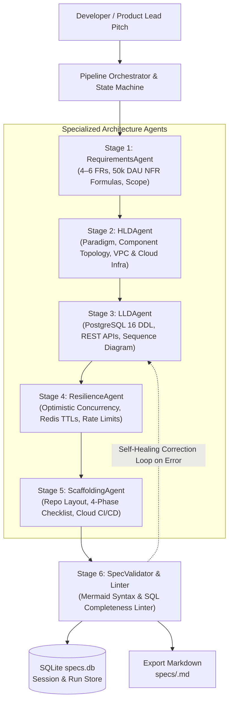

# ⚡ Autonomous System Design Agent Pipeline

[](https://www.python.org/downloads/)
[](#-local-installation--setup-guide)
[](LICENSE)
[](#-testing)

> An autonomous multi-agent engineering pipeline that transforms raw, ambiguous, or early-stage software project ideas into production-ready **Technical Specification Documents** (High-Level Design, Low-Level Design, Cloud Infrastructure, and CI/CD Pipelines) adhering to Principal Architect standards.

---

## 🌟 Key Capabilities

- **Zero-Dependency Core:** Runs out-of-the-box using pure Python 3.10+ standard libraries (`urllib.request`, `http.server`, `dataclasses`, `sqlite3`, `argparse`). No compilation, wheel issues, or fragile package trees.
- **Multi-LLM Support:** Native direct-REST integration with:
  - **Google Gemini** (`gemini-2.5-flash`, `gemini-2.5-pro`, `gemini-2.0-flash`)
  - **Anthropic Claude** (`claude-3-opus-20240229`, `claude-3-7-sonnet-20250219`, `claude-3-5-sonnet-20241022`)
  - **OpenAI** (`gpt-4o`, `gpt-4o-mini`, `o1`, `o3-mini`, `gpt-4-turbo`) with automated reasoning model parameter adaptations
  - **Local Ollama** (`llama3.1:8b`) & **Deterministic Offline Mock** (0 API cost for instant tests)
- **Interactive Dark-Mode Web Dashboard:** Local web application with live Server-Sent Events (SSE) stage-by-stage progress, real-time in-browser **Mermaid.js** diagram rendering, tabbed navigation, and SQLite history search.
- **Strict Architecture Standards:**
  - Complete, executable PostgreSQL 16 DDL (UUIDs, constraints, indexes; zero placeholders or `TODO`s).
  - Explicit REST API contracts (methods, schemas, and HTTP status codes).
  - Valid Mermaid `graph TD` topologies and `sequenceDiagram` transaction flows.
  - 50,000 DAU baseline default with quantified peak RPS and latency formulas.
- **Cloud Infrastructure & CI/CD Pipelines:** VPC network topologies (public, private compute, and isolated DB subnets) and complete GitHub Actions / GitLab CI deployment workflows with zero-downtime rolling/blue-green updates.

---

## 📦 Multi-Agent Pipeline Architecture

The pipeline routes context through 5 specialized agents with a self-correcting validation loop:



---

## 🚀 Local Installation & Setup Guide

### 1. Prerequisites
- **Python 3.10 or higher** installed on your system (macOS, Linux, or Windows).
- **Git** installed.

Check your Python version:
```bash
python3 --version
```

---

### 2. Clone the Repository
```bash
git clone https://github.com/your-username/system_design_agent.git
cd system_design_agent
```

---

### 3. (Optional) Create a Virtual Environment
Since the core pipeline uses Python standard libraries, a virtual environment is optional, but recommended for clean isolation:

```bash
python3 -m venv .venv
source .venv/bin/activate  # On Windows: .venv\Scripts\activate
```

---

### 4. Configure Your API Key
Copy the template environment file:
```bash
cp .env.example .env
```

Open `.env` in your text editor and add the API key for your preferred provider:

#### For Google Gemini (Recommended & Blazing Fast):
```ini
LLM_PROVIDER=gemini
GEMINI_API_KEY=AIzaSy...
GEMINI_MODEL=gemini-2.5-flash
```
*(Get a free Gemini API key at [Google AI Studio](https://aistudio.google.com/apikey))*

#### For Anthropic Claude (Opus / Sonnet):
```ini
LLM_PROVIDER=anthropic
ANTHROPIC_API_KEY=sk-ant-api03-...
ANTHROPIC_MODEL=claude-3-opus-20240229
```
*(Get an Anthropic key at [Anthropic Console](https://console.anthropic.com/))*

#### For OpenAI (GPT-4o / o1 / o3-mini):
```ini
LLM_PROVIDER=openai
OPENAI_API_KEY=sk-...
OPENAI_MODEL=gpt-4o
```
*(Get an OpenAI key at [OpenAI Platform](https://platform.openai.com/api-keys))*

*(Note: You can also leave `.env` empty and enter your API keys directly inside the Web UI Settings modal!)*

---

### 5. Launch the Web UI Dashboard

Run the server:
```bash
python3 -m system_design_agent serve
```
*(Or simply `python3 -m system_design_agent`)*

Open **`http://127.0.0.1:8000`** in your browser.

#### Features in the Web Dashboard:
1. **Interactive Pitch Input:** Type any rough idea or click a quick-fill example chip (e.g. *URL Shortener*, *Cloud GitOps Pipeline*, *Flash Sale Engine*, or *Collab Code Editor*).
2. **Model Selection:** Choose **Gemini 2.5 Flash/Pro**, **Claude 3 Opus**, or **GPT-4o / o3-mini** on the fly.
3. **Live Animated Stepper:** Watch real-time Server-Sent Events (SSE) as each agent executes and validates.
4. **Live Mermaid Rendering:** Architecture topologies and transaction sequence diagrams render immediately in dark mode.
5. **Specification Viewer:** Switch between Full Spec, Requirements, HLD, LLD, Resilience, and Scaffolding tabs.
6. **Actions:** 1-click Markdown download (`.md`) and clipboard copy.
7. **History Sidebar:** Search and re-open previous designs stored in `specs.db`.

---

### 6. Command-Line Interface (CLI) Usage

The application includes a rich command-line tool with colorized status formatting:

#### A. Instant Offline Dry Run (Zero Cost)
Test the entire 6-stage pipeline without consuming any API tokens:
```bash
python3 -m system_design_agent mock "High-throughput URL shortener with analytics and vanity slugs"
```

#### B. Generate Specification with Google Gemini
```bash
python3 -m system_design_agent generate "Distributed real-time flash sale ticketing platform" \
  --provider gemini \
  --model gemini-2.5-flash \
  --dau 100000
```

#### C. Generate Specification with Claude 3 Opus
```bash
python3 -m system_design_agent generate "Multi-region cloud deployment pipeline with ArgoCD and Terraform" \
  --provider anthropic \
  --model claude-3-opus-20240229
```

#### D. Generate Specification with OpenAI GPT-4o
```bash
python3 -m system_design_agent generate "Real-time collaborative code editor with cursor presence" \
  --provider openai \
  --model gpt-4o
```

#### E. Interactive CLI Pitch Wizard
```bash
python3 -m system_design_agent interactive
```

#### F. List Previously Generated Specifications
```bash
python3 -m system_design_agent list
```

---

## 📋 The 5 Specification Sections Generated

Every generated technical specification document strictly adheres to Principal Architect standards:

| Section | Focus Areas | Key Output Artifacts |
| :--- | :--- | :--- |
| **1. Requirements & Core Assumptions** | Functional scope & quantified scale | 4–6 numbered FRs, 50k DAU baseline RPS calculations (average & peak), p95/p99 latency ceilings, read/write ratios, and v1 out-of-scope boundaries. |
| **2. High-Level Design (HLD)** | Architectural paradigm & cloud network | Mermaid `graph TD` topology, Technology Stack Matrix with trade-off rationales, and Cloud VPC / Subnet / IAM topology (AWS/GCP/Azure). |
| **3. Low-Level Design (LLD)** | Data schemas & transaction flows | Complete PostgreSQL 16 DDL (`CREATE TABLE`, constraints, B-tree/GIN indexes; zero placeholders), REST API contracts table, typed domain models (Python/TypeScript), and Mermaid `sequenceDiagram`. |
| **4. Resilience, Concurrency & Security** | Race conditions & state hardening | Optimistic Concurrency Control (OCC) with version columns, Redis distributed lock patterns, Cache-Aside invalidation rules with TTLs, and sliding window rate limiting. |
| **5. Developer Action Plan & Scaffolding** | Repository layout & deployment | Modular repository directory tree, **Cloud CI/CD & Deployment Pipeline blueprint** (GitHub Actions, container security scanning, DB migration pre-hooks, zero-downtime rolling/canary rollouts, and OpenTelemetry observability), and a 4-phase developer checklist. |

---

## 🧪 Testing

The repository contains an automated test suite covering Mermaid syntax linting, PostgreSQL DDL validation, SSL keystore resolution, mock client execution, and REST endpoints:

```bash
python3 -m unittest discover tests
```

*Expected output: `Ran 20 tests in ~0.02s - OK`*

---

## 🛠️ Architecture & Troubleshooting

### macOS OpenSSL Root Certificate Verification Fix
On macOS, standard Python installations often do not link the operating system's keychain certificates into OpenSSL, resulting in `[SSL: CERTIFICATE_VERIFY_FAILED]` when connecting to external LLM APIs.

This repository includes a built-in automated SSL context resolver in **[`ssl_context.py`](system_design_agent/llm/ssl_context.py)** that automatically locates and binds the 118+ verified Apple root certificates at `/etc/ssl/cert.pem` into all HTTPS requests. No manual certificate installation is required.

---

## 📄 License

Distributed under the MIT License. See `LICENSE` for more information.
