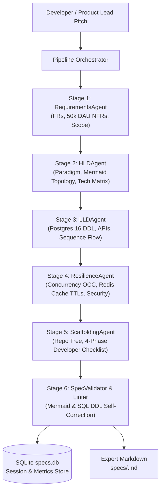

# Autonomous System Design Agent Pipeline

> An autonomous multi-agent pipeline that transforms raw, ambiguous, or early-stage software project ideas into production-ready **Technical Specification Documents** (High-Level Design and Low-Level Design) adhering to Principal Architect standards.

---

## 🎯 Architectural Mission & Strict Standards

1. **Concrete Over Descriptive:** Never outputs vague advice like *"use a cache"*. Specifies concrete tools (PostgreSQL 16, Redis 7.2, RS256 JWTs), exact column data types, and trade-off rationales.
2. **Actionable Code Artifacts:** Generates complete, runnable SQL DDL with constraints & indexes (zero placeholders like `...` or `TODO`), strongly typed domain models, and API contracts.
3. **Valid Visualizations:** Valid, renderable Mermaid.js diagrams for component topology (`graph TD`) and transaction execution flows (`sequenceDiagram`).
4. **Intelligent 50,000 DAU Baseline:** Automatically calculates throughput, peak RPS, and latency ceilings calibrated for a 50k DAU production MVP whenever constraints are omitted.

---

## 📦 Pipeline Architecture

The pipeline executes a 6-stage workflow with self-healing feedback loops:



---

## 🚀 Quick Start (Zero External Dependencies Required!)

The core pipeline is built strictly with Python 3.10+ standard libraries (`urllib.request`, `dataclasses`, `sqlite3`, `argparse`). No third-party packages are strictly needed to run out-of-the-box!

### 1. Run a Dry Run / Mock Generation (Offline & Instant)
```bash
python3 -m system_design_agent mock "A high-throughput URL shortener with real-time click analytics and vanity domains"
```

### 2. Configure LLM API Keys
Copy `.env.example` to `.env`:
```bash
cp .env.example .env
```
Fill in your preferred provider:
- **Google Gemini:** `GEMINI_API_KEY=your_key_here` (Default: `gemini-2.5-flash`)
- **OpenAI:** `OPENAI_API_KEY=your_key_here` (Default: `gpt-4o`)
- **Ollama (Local LLM):** Set `LLM_PROVIDER=ollama` and `OLLAMA_MODEL=llama3.1:8b`

### 3. Generate a Real Specification
```bash
python3 -m system_design_agent generate "Real-time collaborative whiteboarding canvas with infinite zoom and live cursor presence" --dau 100000
```

### 4. Interactive Mode
```bash
python3 -m system_design_agent interactive
```

### 5. View Previously Generated Specifications
```bash
python3 -m system_design_agent list
```

---

## 📋 The 5 Generated Specification Sections

Every generated document contains:
- **1. Requirements & Core Assumptions:** 4–6 numbered FRs, quantified NFRs (Average & Peak RPS derived from DAU, p95/p99 latency ceilings, read/write ratios), and v1 Out-of-Scope boundaries.
- **2. High-Level Design (HLD):** Architectural paradigm with trade-off rationale, Mermaid `graph TD` topology, and Technology Stack Matrix.
- **3. Low-Level Design (LLD):** Complete PostgreSQL 16 SQL DDL (with UUIDs, foreign keys, constraints, and B-tree/GIN indexes), REST API contracts table, typed Python domain entities, and Mermaid `sequenceDiagram`.
- **4. Resilience, Concurrency & Security:** Optimistic Concurrency Control (OCC) snippets, Redis distributed lock policies, Cache-Aside invalidation rules & TTLs, and rate-limiting rules.
- **5. Developer Action Plan & Scaffolding:** Clean modular repository directory tree and a 4-phase, checkbox-formatted implementation checklist.

---

## 🧪 Testing

Run the automated test suite covering Mermaid syntax linting, SQL placeholder detection, and end-to-end pipeline orchestration:

```bash
python3 -m unittest discover tests
```
