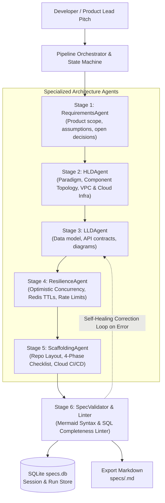

# ⚡ Autonomous System Design Agent Pipeline

[](https://www.python.org/downloads/)
[](#-local-installation--setup-guide)
[](LICENSE)
[](#-testing)

> An interactive system design agent that uses the [System Design Starter skill](https://github.com/Surya760/system-design-starter) to turn a new idea or existing project into a practical, reviewable architecture and build plan.

---

## 🌟 Key Capabilities

- **Zero-Dependency Core:** Runs out-of-the-box using pure Python 3.10+ standard libraries (`urllib.request`, `http.server`, `dataclasses`, `sqlite3`, `argparse`). No compilation, wheel issues, or fragile package trees.
- **Multi-LLM Support:** Native direct-REST integration with:
  - **Google Gemini** (`gemini-2.5-flash`, `gemini-2.5-pro`, `gemini-2.0-flash`)
  - **Anthropic Claude** (`claude-3-opus-20240229`, `claude-3-7-sonnet-20250219`, `claude-3-5-sonnet-20241022`)
  - **OpenAI** (`gpt-4o`, `gpt-4o-mini`, `o1`, `o3-mini`, `gpt-4-turbo`) with automated reasoning model parameter adaptations
  - **Local Ollama** (`llama3.1:8b`) & **Deterministic Offline Mock** (0 API cost for instant tests)
- **Skill-Guided Design:** Bundles System Design Starter and loads focused cloud, data, API, or CI/CD references for relevant design stages.
- **Interactive Dark-Mode Dashboard:** Live progress plus a diagram canvas with pan/zoom, selectable architecture/data/sequence diagrams, node inspection, and SVG export.
- **Reviewable Design Bundle:** Exports the full specification, Mermaid source diagrams, and API contract artifacts when generated.
- **Buildable Architecture:** Selects technologies to fit stated needs, surfaces unknowns as open decisions, and includes cloud prerequisites and release planning when relevant.

---

## 📦 Multi-Agent Pipeline Architecture

### System Design Starter skill integration

The complete skill and its references live in `system_design_agent/skills/system-design-starter/`. The requirements stage receives the core skill. Architecture, data/API, and deployment stages also receive only their relevant reference guides. This keeps the app self-contained and avoids downloading instructions or sending prompts to an external source at runtime. To update the skill, sync its `SKILL.md` and `references/` from the upstream repository and review the prompts and exporter.

The pipeline routes context through 5 specialized agents with a self-correcting validation loop:



---

## 🚀 Local Installation & Setup Guide

### 1. Prerequisites
- **Python 3.10 or higher** installed on your system (macOS, Linux, or Windows).
- **Git** installed.

Check your Python version:
```bash
python3 --version
```

---

### 2. Clone the Repository
```bash
git clone https://github.com/your-username/system_design_agent.git
cd system_design_agent
```

---

### 3. (Optional) Create a Virtual Environment
Since the core pipeline uses Python standard libraries, a virtual environment is optional, but recommended for clean isolation:

```bash
python3 -m venv .venv
source .venv/bin/activate  # On Windows: .venv\Scripts\activate
```

---

### 4. Configure Your API Key
Copy the template environment file:
```bash
cp .env.example .env
```

Open `.env` in your text editor and add the API key for your preferred provider:

#### For Google Gemini (Recommended & Blazing Fast):
```ini
LLM_PROVIDER=gemini
GEMINI_API_KEY=AIzaSy...
GEMINI_MODEL=gemini-2.5-flash
```
*(Get a free Gemini API key at [Google AI Studio](https://aistudio.google.com/apikey))*

#### For Anthropic Claude (Opus / Sonnet):
```ini
LLM_PROVIDER=anthropic
ANTHROPIC_API_KEY=sk-ant-api03-...
ANTHROPIC_MODEL=claude-3-opus-20240229
```
*(Get an Anthropic key at [Anthropic Console](https://console.anthropic.com/))*

#### For OpenAI (GPT-4o / o1 / o3-mini):
```ini
LLM_PROVIDER=openai
OPENAI_API_KEY=sk-...
OPENAI_MODEL=gpt-4o
```
*(Get an OpenAI key at [OpenAI Platform](https://platform.openai.com/api-keys))*

*(Note: You can also leave `.env` empty and enter your API keys directly inside the Web UI Settings modal!)*

---

### 5. Launch the Web UI Dashboard

Run the server:
```bash
python3 -m system_design_agent serve
```
*(Or simply `python3 -m system_design_agent`)*

Open **`http://127.0.0.1:8000`** in your browser.

#### Features in the Web Dashboard:
1. **Interactive Pitch Input:** Type any rough idea or click a quick-fill example chip (e.g. *URL Shortener*, *Cloud GitOps Pipeline*, *Flash Sale Engine*, or *Collab Code Editor*).
2. **Model Selection:** Choose **Gemini 2.5 Flash/Pro**, **Claude 3 Opus**, or **GPT-4o / o3-mini** on the fly.
3. **Live Animated Stepper:** Watch real-time Server-Sent Events (SSE) as each agent executes and validates.
4. **Interactive Visual Design:** Switch diagrams, zoom and pan the canvas, inspect nodes, copy Mermaid source, or download SVG.
5. **Specification Viewer:** Switch between Full Spec, Requirements, HLD, LLD, Resilience, Scaffolding, and Visual Design tabs.
6. **Actions:** Download Markdown or a ZIP design bundle, or copy the specification.
7. **History Sidebar:** Search and re-open previous designs stored in `specs.db`.

Each design is saved in `specs/<design-slug>/` with `system-design.md`, Mermaid source diagrams, and API contract files when the model produced those artifacts. Use **Download design bundle** in the viewer to get the folder as a ZIP. The expected daily users field is optional; when omitted, the generated document marks scale as unspecified.

---

### 6. Command-Line Interface (CLI) Usage

The application includes a rich command-line tool with colorized status formatting:

#### A. Instant Offline Dry Run (Zero Cost)
Test the entire 6-stage pipeline without consuming any API tokens:
```bash
python3 -m system_design_agent mock "High-throughput URL shortener with analytics and vanity slugs"
```

#### B. Generate Specification with Google Gemini
```bash
python3 -m system_design_agent generate "Distributed real-time flash sale ticketing platform" \
  --provider gemini \
  --model gemini-2.5-flash \
  --dau 100000
```

#### C. Generate Specification with Claude 3 Opus
```bash
python3 -m system_design_agent generate "Multi-region cloud deployment pipeline with ArgoCD and Terraform" \
  --provider anthropic \
  --model claude-3-opus-20240229
```

#### D. Generate Specification with OpenAI GPT-4o
```bash
python3 -m system_design_agent generate "Real-time collaborative code editor with cursor presence" \
  --provider openai \
  --model gpt-4o
```

#### E. Interactive CLI Pitch Wizard
```bash
python3 -m system_design_agent interactive
```

#### F. List Previously Generated Specifications
```bash
python3 -m system_design_agent list
```

---

## 📋 The 5 Specification Sections Generated

The agent follows System Design Starter and tailors output to the idea and its constraints:

| Section | Focus Areas | Key Output Artifacts |
| :--- | :--- | :--- |
| **1. Requirements & Assumptions** | Product scope, journeys, constraints, and open decisions | Requirements grounded in the prompt; unknown scale and policies labeled. |
| **2. High-Level Design** | Architecture and technology choices | Mermaid topology, component responsibilities, alternatives, tradeoffs, and deployment architecture when requested. |
| **3. Low-Level Design** | Data and interfaces | Data model, Mermaid ERD, API contract files when an API is in scope, and sequence flow. |
| **4. Reliability & Security** | Failure behavior and operational safety | Data consistency, retries, identity, secrets, privacy, and recovery tailored to the design. |
| **5. Delivery Plan** | Build and release path | Prerequisites, cloud deployment stages, CI/CD promotion, rollback, and implementation milestones. |

The visual canvas gathers Mermaid diagrams from the generated design. If a model does not produce a diagram, the canvas reports that gap instead of inventing an architecture.

---

## 🧪 Testing

The repository contains an automated test suite covering Mermaid syntax linting, PostgreSQL DDL validation, SSL keystore resolution, mock client execution, and REST endpoints:

```bash
python3 -m unittest discover tests
```

*Expected output: `Ran 20 tests in ~0.02s - OK`*

---

## 🛠️ Architecture & Troubleshooting

### macOS OpenSSL Root Certificate Verification Fix
On macOS, standard Python installations often do not link the operating system's keychain certificates into OpenSSL, resulting in `[SSL: CERTIFICATE_VERIFY_FAILED]` when connecting to external LLM APIs.

This repository includes a built-in automated SSL context resolver in **[`ssl_context.py`](system_design_agent/llm/ssl_context.py)** that automatically locates and binds the 118+ verified Apple root certificates at `/etc/ssl/cert.pem` into all HTTPS requests. No manual certificate installation is required.

---

## 📄 License

Distributed under the MIT License. See `LICENSE` for more information.
