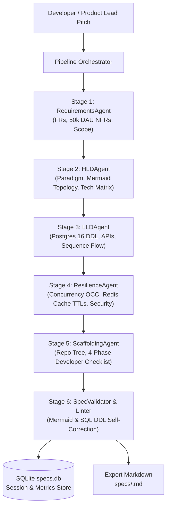

# Autonomous System Design Agent Pipeline

> An autonomous multi-agent pipeline that transforms raw, ambiguous, or early-stage software project ideas into production-ready **Technical Specification Documents** (High-Level Design and Low-Level Design) adhering to Principal Architect standards.

---

## 🎯 Architectural Mission & Strict Standards

1. **Concrete Over Descriptive:** Never outputs vague advice like *"use a cache"*. Specifies concrete tools (PostgreSQL 16, Redis 7.2, RS256 JWTs), exact column data types, and trade-off rationales.
2. **Actionable Code Artifacts:** Generates complete, runnable SQL DDL with constraints & indexes (zero placeholders like `...` or `TODO`), strongly typed domain models, and API contracts.
3. **Valid Visualizations:** Valid, renderable Mermaid.js diagrams for component topology (`graph TD`) and transaction execution flows (`sequenceDiagram`).
4. **Intelligent 50,000 DAU Baseline:** Automatically calculates throughput, peak RPS, and latency ceilings calibrated for a 50k DAU production MVP whenever constraints are omitted.

---

## 📦 Pipeline Architecture

The pipeline executes a 6-stage workflow with self-healing feedback loops:



---

## 🚀 Quick Start (Zero External Dependencies Required!)

The core pipeline and Web dashboard are built strictly with Python 3.10+ standard libraries (`urllib.request`, `http.server`, `dataclasses`, `sqlite3`). No third-party packages are needed to run!

### 1. Launch the Interactive Web UI
Simply run:
```bash
python3 -m system_design_agent serve
# or simply:
python3 -m system_design_agent
```
Open **`http://127.0.0.1:8000`** in your browser:
- Real-time animated 6-stage multi-agent progress stepper.
- Live-rendered **Mermaid architecture diagrams** and sequence flows.
- Tabbed section view (Requirements, HLD, LLD, Resilience, Action Plan).
- 1-click Markdown export and copy.
- History sidebar storing all generated specs in SQLite `specs.db`.
- Input your `GEMINI_API_KEY` directly in Settings or via `.env`.

### 2. Configure LLM API Keys (Gemini or Claude Opus)
Copy `.env.example` to `.env`:
```bash
cp .env.example .env
```
Add your preferred key(s):
- **Anthropic Claude (Opus):**
  ```bash
  ANTHROPIC_API_KEY=sk-ant-api03-...
  ANTHROPIC_MODEL=claude-3-opus-20240229
  ```
- **Google Gemini:**
  ```bash
  GEMINI_API_KEY=AIzaSy...
  GEMINI_MODEL=gemini-2.5-flash
  ```

### 3. Command-Line Interface (CLI)
```bash
# Generate with Claude 3 Opus
python3 -m system_design_agent generate "Real-time collaborative code editor" --provider anthropic --model claude-3-opus-20240229

# Generate with Gemini 2.5 Flash
python3 -m system_design_agent generate "Distributed event-driven ticketing engine" --provider gemini

# Offline Dry Run with Mock Agent (0 API tokens consumed)
python3 -m system_design_agent mock "High-throughput URL shortener with analytics"

# Interactive CLI Pitch Wizard
python3 -m system_design_agent interactive

# List Generated Specifications
python3 -m system_design_agent list
```

---

## 📋 The 5 Generated Specification Sections

Every generated document contains:
- **1. Requirements & Core Assumptions:** 4–6 numbered FRs, quantified NFRs (Average & Peak RPS derived from DAU, p95/p99 latency ceilings, read/write ratios), and v1 Out-of-Scope boundaries.
- **2. High-Level Design (HLD):** Architectural paradigm with trade-off rationale, Mermaid `graph TD` topology, and Technology Stack Matrix.
- **3. Low-Level Design (LLD):** Complete PostgreSQL 16 SQL DDL (with UUIDs, foreign keys, constraints, and B-tree/GIN indexes), REST API contracts table, typed Python domain entities, and Mermaid `sequenceDiagram`.
- **4. Resilience, Concurrency & Security:** Optimistic Concurrency Control (OCC) snippets, Redis distributed lock policies, Cache-Aside invalidation rules & TTLs, and rate-limiting rules.
- **5. Developer Action Plan & Scaffolding:** Clean modular repository directory tree and a 4-phase, checkbox-formatted implementation checklist.

---

## 🧪 Testing

Run the automated test suite covering Mermaid syntax linting, SQL placeholder detection, and end-to-end pipeline orchestration:

```bash
python3 -m unittest discover tests
```
