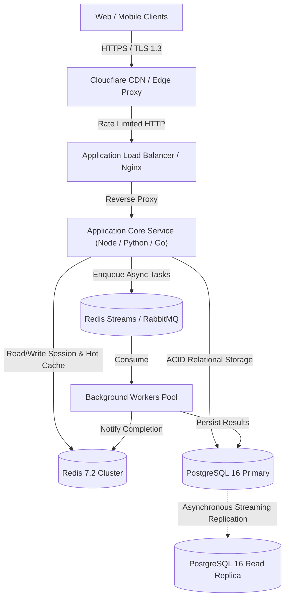
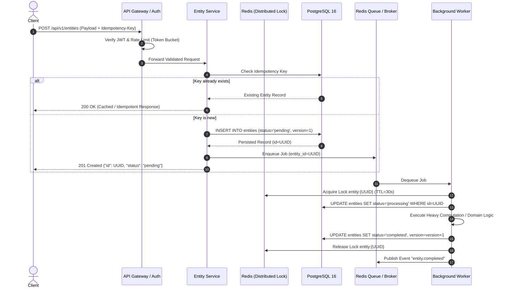

# Technical Specification: Real-Time Collaborative Code Editor

> **Document Type:** Production Engineering Blueprint (HLD + LLD)  
> **Target Baseline Scale:** ~50,000 Daily Active Users (DAU)  
> **Specification ID:** `105defb1-eb98-4daa-a544-d33c6f1c0b2e`  
> **Generated At:** 2026-11-08T13:21:36.057629+00:00  

## Executive Summary & Raw Pitch
Real-time collaborative code editor

---

## 1. Requirements & Core Assumptions
### 1. Requirements & Core Assumptions

#### Functional Requirements (FRs)
1. **FR-1 (Ingestion & Registration):** The system must accept and validate incoming client requests for """Real-time collaborative code editor""", authenticating callers and registering new entities with idempotency keys.
2. **FR-2 (Core Processing Engine):** The system must process transactions, perform state transitions, and enforce domain business invariants synchronously for low-latency queries and asynchronously for compute-heavy tasks.
3. **FR-3 (Query & State Retrieval):** The system must support paginated, filtered retrieval of entity status, historical event audit trails, and aggregated metrics.
4. **FR-4 (Event Notification & Dispatch):** The system must dispatch real-time webhooks and websocket/event notifications to downstream subscribers upon transaction completion.
5. **FR-5 (Lifecycle & Revocation):** The system must allow authorized actors to cancel, pause, update, or soft-delete existing jobs/records with full state preservation.

#### Non-Functional Requirements (NFRs)
- **Scale Baseline:** Calibrated for **50,000 Daily Active Users (DAU)**.
- **Throughput & RPS:**
  - Average Daily Requests: 50,000 DAU × 20 interactions/day = 1,000,000 requests/day.
  - Average Load: ~12 requests/second (RPS).
  - Peak Multiplier: 6× to 10× during burst windows = **80–120 Peak RPS**.
- **Latency Ceilings:**
  - Read Path: p95 < 50ms, p99 < 120ms.
  - Write / Mutating Path: p95 < 150ms, p99 < 300ms.
  - Async Job Completion: p95 < 2.5 seconds.
- **Read/Write Ratio:** 8:1 (Read-heavy profile).
- **Availability Target:** 99.9% uptime (~8.76 hours maximum allowable downtime/year).
- **Data Durability:** Zero uncommitted data loss for completed transactions (RPO = 0, RTO < 15 minutes).

#### Assumptions & Out-of-Scope (v1)
- **Assumptions:** Single primary geographic region (e.g., AWS us-east-1) with Multi-AZ database replication; standard OAuth2/JWT identity verification provided by an existing identity provider.
- **Out-of-Scope (v1):** Multi-region active-active database replication; complex multi-currency ledger conversions; on-premise hardware deployments; machine learning model fine-tuning pipelines.

---

## 2. High-Level Design (HLD)
### 2. High-Level Design (HLD)

#### Architectural Paradigm
**Modular Monolith with Asynchronous Worker Decoupling.**
*Rationale:* For an MVP targeting 50,000 DAU (peak ~120 RPS), a microservices architecture introduces unnecessary operational complexity, network serialization overhead, and distributed transaction challenges. A clean modular monolith with strict domain boundaries and background job queues easily handles this scale while maintaining single-deploy velocity and low hosting costs.

#### Component Topology Diagram


#### Technology Stack Matrix

| Layer | Technology Choice | Trade-off Rationale |
| :--- | :--- | :--- |
| **Runtime / Language** | Python 3.12+ (or TypeScript / Go) | High developer velocity, rich ecosystem, and robust async I/O. |
| **Web Framework** | FastAPI (ASGI) | Native OpenAPI documentation, Pydantic type safety, and async concurrency. |
| **Primary Database** | PostgreSQL 16 | Proven relational ACID guarantees, JSONB flexibility, and transactional integrity. |
| **Cache & Task Queue** | Redis 7.2 (Sentinel / Streams) | Sub-millisecond latency for session caching and lightweight queueing without Kafka overhead. |
| **Hosting & Infra** | AWS ECS Fargate + RDS Multi-AZ | Fully managed containers and automated database backups with zero manual host maintenance. |

---

## 3. Low-Level Design (LLD)
### 3. Low-Level Design (LLD)

#### Data Layer / Database Schema (PostgreSQL 16)
```sql
-- Core Extensions
CREATE EXTENSION IF NOT EXISTS "uuid-ossp";
CREATE EXTENSION IF NOT EXISTS "pgcrypto";

-- Enum Types
CREATE TYPE user_role AS ENUM ('admin', 'member', 'service_account');
CREATE TYPE entity_status AS ENUM ('pending', 'processing', 'completed', 'failed', 'archived');

-- Users Table
CREATE TABLE users (
    id UUID PRIMARY KEY DEFAULT gen_random_uuid(),
    email VARCHAR(255) NOT NULL UNIQUE,
    password_hash VARCHAR(255) NOT NULL,
    role user_role NOT NULL DEFAULT 'member',
    is_active BOOLEAN NOT NULL DEFAULT TRUE,
    created_at TIMESTAMPTZ NOT NULL DEFAULT CURRENT_TIMESTAMP,
    updated_at TIMESTAMPTZ NOT NULL DEFAULT CURRENT_TIMESTAMP
);

-- Core Entities Table
CREATE TABLE entities (
    id UUID PRIMARY KEY DEFAULT gen_random_uuid(),
    user_id UUID NOT NULL REFERENCES users(id) ON DELETE CASCADE,
    title VARCHAR(200) NOT NULL,
    payload JSONB NOT NULL DEFAULT '{}'::jsonb,
    status entity_status NOT NULL DEFAULT 'pending',
    version INT NOT NULL DEFAULT 1,
    idempotency_key VARCHAR(128) UNIQUE,
    created_at TIMESTAMPTZ NOT NULL DEFAULT CURRENT_TIMESTAMP,
    updated_at TIMESTAMPTZ NOT NULL DEFAULT CURRENT_TIMESTAMP,
    CONSTRAINT check_title_length CHECK (char_length(title) >= 3)
);

-- Audit Events Table
CREATE TABLE entity_audit_logs (
    id BIGSERIAL PRIMARY KEY,
    entity_id UUID NOT NULL REFERENCES entities(id) ON DELETE CASCADE,
    actor_id UUID REFERENCES users(id) ON DELETE SET NULL,
    action VARCHAR(64) NOT NULL,
    state_delta JSONB NOT NULL,
    created_at TIMESTAMPTZ NOT NULL DEFAULT CURRENT_TIMESTAMP
);

-- Indexes for Performance
CREATE INDEX idx_users_email ON users (email);
CREATE INDEX idx_entities_user_status ON entities (user_id, status);
CREATE INDEX idx_entities_created_at ON entities (created_at DESC);
CREATE INDEX idx_entities_payload_gin ON entities USING GIN (payload);
CREATE INDEX idx_audit_entity_id ON entity_audit_logs (entity_id, created_at DESC);
```

#### API Contracts

| Method | Endpoint Path | Auth | Request Body | Response Body | Status Codes |
| :--- | :--- | :--- | :--- | :--- | :--- |
| `POST` | `/api/v1/entities` | Bearer JWT | `{"title": "string", "payload": {}, "idempotency_key": "uuid"}` | `{"id": "uuid", "status": "pending", "created_at": "iso"}` | `201, 400, 409, 500` |
| `GET` | `/api/v1/entities/{id}` | Bearer JWT | _None_ | `{"id": "uuid", "title": "string", "status": "string", "version": 1}` | `200, 401, 404, 500` |
| `GET` | `/api/v1/entities` | Bearer JWT | Query: `?status=pending&limit=20&cursor=xxx` | `{"items": [...], "next_cursor": "string", "total": 1}` | `200, 400, 401, 500` |
| `PATCH`| `/api/v1/entities/{id}` | Bearer JWT | `{"title": "string", "version": 1}` | `{"id": "uuid", "status": "updated", "version": 2}` | `200, 400, 409, 404` |
| `DELETE`| `/api/v1/entities/{id}`| Bearer JWT | _None_ | `{"message": "Archived successfully"}` | `200, 401, 404, 500` |

#### Core Domain Models (Python / Pydantic v2)
```python
from __future__ import annotations
from datetime import datetime
from enum import Enum
from typing import Any, Dict, Optional
from uuid import UUID
from pydantic import BaseModel, ConfigDict, Field


class EntityStatus(str, Enum):
    PENDING = "pending"
    PROCESSING = "processing"
    COMPLETED = "completed"
    FAILED = "failed"
    ARCHIVED = "archived"


class EntityCreateRequest(BaseModel):
    title: str = Field(..., min_length=3, max_length=200)
    payload: Dict[str, Any] = Field(default_factory=dict)
    idempotency_key: Optional[str] = Field(None, max_length=128)


class EntityResponse(BaseModel):
    model_config = ConfigDict(from_attributes=True)

    id: UUID
    user_id: UUID
    title: str
    payload: Dict[str, Any]
    status: EntityStatus
    version: int
    created_at: datetime
    updated_at: datetime


class EntityPatchRequest(BaseModel):
    title: Optional[str] = Field(None, min_length=3, max_length=200)
    version: int = Field(..., description="Optimistic concurrency control version")
```

#### Execution Flow Sequence Diagram


---

## 4. Resilience, Concurrency & Security
### 4. Resilience, Concurrency & Security

#### Concurrency & State Control
1. **Optimistic Concurrency Control (OCC):**
   - The `entities` table features an integer `version` column.
   - All mutation queries execute conditional atomic updates:
     ```sql
     UPDATE entities 
     SET title = :title, version = version + 1, updated_at = NOW() 
     WHERE id = :id AND version = :expected_version;
     ```
   - If zero rows are returned, the service aborts and responds with `HTTP 409 Conflict`, requiring the client to refresh and retry.
2. **Distributed Locking for Background Tasks:**
   - Background workers use Redis distributed locks (`Redlock` pattern with a 30-second TTL and token validation) keyed on `lock:entity:{id}` to guarantee single-worker processing.
3. **Database Transaction Isolation:**
   - Default isolation level is `READ COMMITTED`. Financial or balance-deducting operations escalate to `SELECT ... FOR UPDATE` with `REPEATABLE READ`.

#### Caching & Invalidation Rules
- **Cache-Aside Pattern:** Hot read paths query Redis before hitting PostgreSQL.
- **Cache Key Namespaces:**
  - `entity:{id}`: TTL 15 minutes (Invalidated synchronously upon `PATCH`/`DELETE`).
  - `user:{id}:profile`: TTL 1 hour.
  - `rate_limit:{user_id}:{minute}`: TTL 60 seconds.
- **Negative Caching:** Cache misses for nonexistent IDs store a sentinel value with a short 30-second TTL to prevent Cache Penetration attacks.
- **Thundering Herd Protection:** Redis mutex locks or probabilistic early expiration (XFetch algorithm) used on high-traffic keys.

#### Security & Rate Limiting
- **Authentication & Authorization:**
  - Stateless Asymmetric JWT (RS256) with short expiry (15 minutes) and Refresh Tokens stored in HTTP-only, Secure, SameSite=Strict cookies.
  - Role-Based Access Control (RBAC) enforced via endpoint middleware.
- **Rate Limiting:**
  - Redis-backed Sliding Window Counter:
    - Anonymous Endpoints: 30 requests/minute per IP.
    - Authenticated Endpoints: 300 requests/minute per User ID.
    - Burst Threshold: Up to 50 requests/second.
- **Data Protection & Sanitization:**
  - TLS 1.3 in transit; AES-256 encryption at rest in PostgreSQL (AWS KMS).
  - Strict input validation via Pydantic; parameterized SQL queries to eliminate SQL Injection.
  - Sensitive logs scrubbed for PII (emails, tokens, passwords).

---

## 5. Developer Action Plan & Scaffolding
### 5. Developer Action Plan & Scaffolding

#### Repository Directory Tree
```
├── .github/
│   └── workflows/
│       ├── ci.yml               # Linting, type checks, unit & integration tests
│       └── cd.yml               # Container build & ECS deployment
├── docker/
│   ├── Dockerfile
│   ├── Dockerfile.worker
│   └── docker-compose.yml       # Local Postgres 16, Redis 7, App & Worker
├── migrations/
│   ├── env.py
│   └── versions/
│       └── 0001_initial_schema.py
├── src/
│   ├── core/
│   │   ├── config.py            # Environment settings (Pydantic BaseSettings)
│   │   ├── database.py          # SQLAlchemy async session pool
│   │   ├── redis.py             # Redis client & lock utilities
│   │   └── security.py          # JWT verification & password hashing
│   ├── domain/
│   │   ├── models.py            # SQLAlchemy ORM models
│   │   └── schemas.py           # Pydantic v2 DTOs & validation
│   ├── services/
│   │   ├── entity_service.py    # Core business logic & state transitions
│   │   └── audit_service.py     # Event audit logger
│   ├── api/
│   │   ├── deps.py              # Auth & database dependency injection
│   │   ├── middleware.py        # Rate limiting & request tracing
│   │   └── v1/
│   │       ├── router.py
│   │       └── endpoints/
│   │           ├── auth.py
│   │           └── entities.py
│   └── workers/
│       ├── celery_app.py        # Worker initialization & task routing
│       └── tasks.py             # Asynchronous processing jobs
├── tests/
│   ├── conftest.py              # Test database fixtures & test client
│   ├── unit/
│   └── integration/
├── .env.example
├── pyproject.toml
└── README.md
```

#### Sequential Implementation Checklist

##### Phase 1: Database Setup, Migrations & Core Models
- [ ] Initialize project with Poetry/UV and configure `pyproject.toml` with pinned dependencies.
- [ ] Setup `docker-compose.yml` with PostgreSQL 16 and Redis 7.2 containers.
- [ ] Configure Alembic migrations and generate `0001_initial_schema.py` from SQL DDL.
- [ ] Define SQLAlchemy ORM models with constraints, UUID keys, and foreign keys.
- [ ] Write DB connection pool manager with health check ping.

##### Phase 2: Core Domain Logic & Service Layer
- [ ] Implement typed Pydantic request/response schemas.
- [ ] Build `EntityService` with transactional state transitions.
- [ ] Implement Optimistic Concurrency Control with version checks.
- [ ] Integrate Redis distributed lock helper (`with redis_lock(...)`).
- [ ] Write unit tests for business rule invariants and conflict handling.

##### Phase 3: API Endpoints, Validation & Auth Middleware
- [ ] Setup FastAPI router hierarchy under `/api/v1`.
- [ ] Implement JWT authentication middleware and token extraction.
- [ ] Build Redis sliding window rate-limiting middleware.
- [ ] Implement CRUD endpoints (`POST`, `GET`, `PATCH`, `DELETE`) with HTTP status codes.
- [ ] Add OpenAPI documentation tags, descriptions, and error schema examples.

##### Phase 4: Async Workers, Caching, Edge Cases & Integration Tests
- [ ] Configure background worker consumer (Redis Streams / Celery).
- [ ] Implement idempotent task processing with de-duplication locks.
- [ ] Wire up Cache-Aside reads and synchronous cache invalidation on updates.
- [ ] Write end-to-end integration tests using `pytest-asyncio` and `httpx`.
- [ ] Setup GitHub Actions CI pipeline for automated testing and coverage thresholds.

---

_Generated by Autonomous System Design Agent_